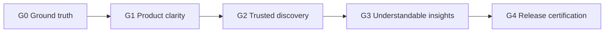

# NOEMA commercial roadmap

Last updated: 2026-10-26

NOEMA is an evidence-first discovery product for human belief, spirituality, ritual, and reports of the unexplained. It is built on comparative-religion datasets, a 17-dimension ontology, source provenance, and candidate correlations. Similarity generates a question, never a conclusion.

This document is the commercial release path. The scientific program remains in [RESEARCH_ROADMAP.md](RESEARCH_ROADMAP.md). Nothing here is a measured result unless it says so. KPI targets and prices are proposals.

## Vision and strategy (one page)

### Product vision
NOEMA exists so a reader can compare belief, ritual, and reports of the unexplained without turning resemblance into an origin story. The public surface shows what is coded, which source it came from, how large the comparison set is, and what is missing. Similarity generates a question, never a conclusion.

### Product strategy
G0 through G4 are the product strategy, in that order.

- **G0 Ground truth.** Show only what the projections contain. Keep provenance and candidate labels. Do not redraw unknown as absence.
- **G1 Product clarity.** A phone visitor can tell what NOEMA is and use Home, Explore, Atlas, Connections, and Research without WebGL.
- **G2 Trusted discovery.** A flagship journey ends at a sourced record or an explicit gap.
- **G3 Understandable insights.** Pattern and comparison views lead with the denominator, the missingness rule, and an unresolved confounder.
- **G4 Release certification.** Accessibility, Core Web Vitals, and the browser checks a buyer would notice.

### Monetization
Proposal only. Not a price and not evidence of demand. The longer note is under [Monetization and positioning](#monetization-and-positioning).

- **Buyers.** A research seat, a library or department, or a methods or data partnership.
- **Free tier.** The public reading surface, including the journeys, with candidates labelled and sources attached.
- **Will not sell.** Certainty, spiritual advice, diagnosis, or a ranked “most ancient” tradition.

### When commercial proof starts
Price, pilots, and economics start only after G4. Until that gate is met, this roadmap does not set a price or claim a customer.

## Release gates

### G0 — Ground truth

The public site shows only what the projections actually contain.

- Every shown claim keeps its source, scope, and epistemic status.
- Candidates stay labelled as candidates. They are not promoted to findings.
- Unknown is not redrawn as absence. Similarity is not redrawn as ancestry, diffusion, or cause.
- Reference images stay reference images.
- A visual audit exists for every HTML page, with screenshots and a machine-readable report.

### G1 — Product clarity

A new visitor can tell what NOEMA is and where to go, on a phone, without WebGL.

- Home is a page, not a redirect into the observatory.
- One primary navigation: Home, Explore, Atlas, Connections, Research.
- The 3D observatory is an optional depth layer.
- P0 reading paths work when WebGL or remote media fail.
- Touch targets on primary controls are at least 44px. `prefers-reduced-motion` is respected.

### G2 — Trusted discovery

Five flagship journeys are completable from the home page into evidence, each still carrying provenance and the candidate label where a pattern is only a candidate.

1. Odin and Norse magic
2. Wicca and witchcraft
3. Ancestors and spirits
4. Shamanism, nature, and altered states
5. Unexplained experiences

A journey is trusted when the visitor can see what is coded, what is missing, which source family it came from, and which rival explanations remain open. Empty or thin coverage is an acceptable result.

### G3 — Understandable insights

Pattern and comparison views lead with a denominator and a caveat.

- Show the cohort size and the number of comparable profiles (`n`), not a bare percentage.
- State the missingness rule in the same view as the candidate.
- Name at least one unresolved confounder (phylogeny, geography, contact, source dependence, or chronology).
- Do not display a probability, origin date, or causal arrow the model has not earned.

### G4 — Release certification

Ship only after the product is usable and honest under the same checks a buyer would notice.

- Accessibility: keyboard reach, visible focus, skip link, labelled navigation, and no information that exists only in color or motion.
- Core Web Vitals on the P0 templates, field or lab: LCP ≤ 2.5s, INP ≤ 200ms, CLS ≤ 0.1.
- The MVP browser checks stay green: no home redirect, primary targets resolve, no horizontal overflow on P0 at 390px, no console errors on P0.
- Publication gate still refuses automatic claim promotion.

## Where this tree sits

Checked 2026-10-26 on branch `cursor/noema-mobile-mvp-8193`. Evidence is lab-only (Playwright and a mobile Lighthouse run against the local static server). Nothing here is a field Core Web Vitals measurement.

| Gate | Status | Evidence |
| --- | --- | --- |
| G0 Ground truth | Partly met | Journey copy is assembled from `belief-catalog-v1.json`, the compact search index, museum media, and reviewed media. `profile_status`, `evidence_status`, and candidate labels are rendered as stored. seiðr, event date, and the encyclopedia source date are visible gaps. Playwright: `Odin journey shows a source locator and the seiðr gap`. |
| G1 Product clarity | Partly met | Home is not a redirect. Primary nav is Home, Explore, Atlas, Connections, Research. User-facing legacy pages load that nav. `dashboard-v1.html` and `observatory-v6.html` stay out of the primary five, per [audit/PAGE_DISPOSITION.md](audit/PAGE_DISPOSITION.md). Playwright covers P0 and those legacy URLs for 390px overflow and console errors. |
| G2 Trusted discovery | Partly met | Odin opens from the Home flagship card, Home search, and Explore results for Odin (`journey.html?id=odin-seidr`) and shows a Britannica locator with `REFERENCE_ONLY`. The other four journeys render only records that exist and are marked `IN_PROGRESS`. Candidate misread rate is still not measured. |
| G3 Understandable insights | Met on the first-visit surfaces in the Playwright check | Explore (`#exploreDenom`), the Odin journey (`#denominator` above the comparison), Compare (`#compareDenom`), and Connections (`#connectionDenom`) lead with a source or cohort count and a missingness line. Home, Pattern Lab, the observatory pattern marquee, and entity profiles use the same lead. Playwright: `denominator leads on Explore, the Odin journey, Compare, and Connections`. Candidate misread rate is still not measured. |
| G4 Release certification | Partly met in the lab | [audit/lighthouse-mobile.md](audit/lighthouse-mobile.md): Explore LCP 1.35s, Odin journey LCP 1.20s, observatory CLS 0. Observatory LCP is 3.50s. Field INP and a full accessibility audit are still open. Three.js loads only after “Open the 3D view”. |

## KPI scorecard

These are proposals for what to instrument. No baseline has been measured in production.

| Signal | Proposal | Gate | Status |
| --- | --- | --- | --- |
| Home stays on Home | 0 meta refreshes | G1 | Addressed in this MVP; re-check in CI |
| P0 overflow at 390px | 0 pages | G1 | Covered by Playwright |
| P0 console errors | 0 | G1 | Covered by Playwright |
| Flagship journey completion | Visitor reaches a sourced record or an explicit empty state | G2 | Odin path covered by Playwright. Four scaffolds are explicit in-progress states. |
| Candidate misread rate | Share of sessions that treat a candidate as a conclusion, from moderated review | G2–G3 | Not measured |
| Provenance visible | 100% of claim-like statements in the journey show a source or an explicit gap | G2 | Odin journey shows the Britannica locator, `REFERENCE_ONLY`, and gaps where a field is absent. Not certified for every page. |
| Insight with denominator | 100% of public pattern rows show `n` and a caveat | G3 | Leading denominator is on the first-visit surfaces named in the gate table. Not certified for every legacy workbench. |
| LCP / INP / CLS | ≤ 2.5s / ≤ 200ms / ≤ 0.1 | G4 | Lab only. Explore 1.35s, Odin journey 1.20s, Home 2.27s, observatory CLS 0. Observatory LCP 3.50s. INP was not collected. |
| Accessibility blockers | 0 critical issues on P0 | G4 | Lighthouse accessibility scores are in the same lab note. Not a manual audit. |

## Deliberately deferred

- Accounts, billing, teams, and saved workspaces.
- Any price, seat, or API quota. See the proposal below; it is not a launched offer.
- Promoting candidates into approved claims, probabilities, or origin stories.
- Phylogenetic comparative models, covariance-aware spatial models, and a contact network. Those stay on the research roadmap until they exist as models.
- Rewriting every legacy research page into the new visual system. Shared nav and overflow fixes now cover the linked legacy pages. `dashboard-v1.html` and `observatory-v6.html` are still separate surfaces.
- Deleting superseded HTML. See [audit/PAGE_DISPOSITION.md](audit/PAGE_DISPOSITION.md).
- Replacing the observatory’s remote Three.js build with a vendored runtime. The page already remains usable when that script fails.

## Monetization and positioning

Proposal only. Not a price list and not evidence of demand.

**Who it is for.** Researchers, documentary and education editors, and cultural institutions who need to compare beliefs and rituals without collapsing resemblance into a single origin story.

**Who pays, and why.**

- A research seat pays for trusted traversal: provenance, denominators, and explicit unknowns, instead of an unsourced summary.
- A library or department pays for shared reading access to the same gated projections, with export of citations rather than of private corpora.
- A methods or data partnership pays to keep a source family inside the publication gate. That fee does not buy a claim.

**What stays free.** The public reading surface, including the five journeys, with candidates labelled and sources attached. The free tier is the evidence of the product, not a stripped demo that hides uncertainty.

**What we will not sell.** Certainty, spiritual advice, diagnosis, or a ranked “most ancient” tradition.
